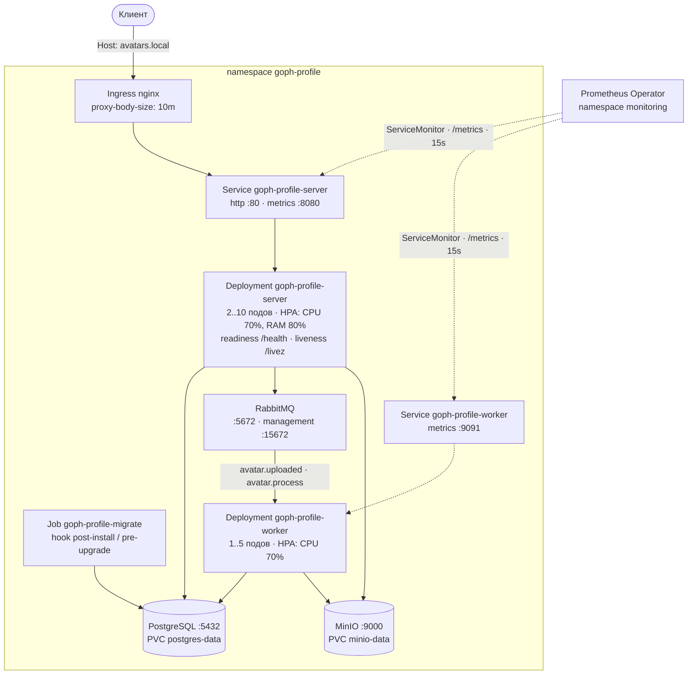

# GophProfile — микросервис аватарок

Пользователь загружает фотографию один раз, а сторонние платформы (блоги, форумы,
сервисы комментариев) запрашивают аватарку по идентификатору пользователя.
Если аватарки нет — отдаётся заглушка (появится на следующих этапах).

## Стек

- **Go 1.27**, HTTP-роутер **chi**
- **PostgreSQL 16** — метаданные аватарок; миграции через **goose** (up/down, встроены в бинарник)
- **MinIO** (S3-совместимо) — файлы изображений
- **RabbitMQ** — события обработки, ретраи с экспоненциальным backoff через DLX
- **OpenTelemetry** — трейсинг (HTTP, PostgreSQL, S3, RabbitMQ), метрики, корреляция логов
- **Prometheus + Grafana + Loki + Jaeger + Alertmanager** — мониторинг локального стенда
- **Docker Compose** — локальный стенд
- **Kubernetes + Helm** — деплой в кластер: Deployment, Service, Ingress, HPA, ServiceMonitor, NetworkPolicy
- Тесты: unit (pgxmock, testify), интеграционные (testcontainers-go, testify/suite), `golangci-lint`

## Архитектура

```
                        ┌─────────────┐   AvatarUploadEvent   ┌────────────┐
POST /api/v1/avatars ─▶ │    server   │ ─────────────────────▶ │  RabbitMQ  │
  (multipart)           └──────┬──────┘   AvatarDeleteEvent   └─────┬──────┘
                              │  файл                    AvatarProcessEvent│
                              ▼                                     ┌─────▼─────┐
                        ┌──────────┐                                │   worker  │
                        │   MinIO  │  ◀── скачать оригинал ──────── │  ресайз   │
                        │   (S3)   │  ◀── загрузить миниатюры ───── │ 100/300px │
                        └──────────┘  ◀── удалить файлы ────────────└───────────┘
                        ┌──────────┐
                        │PostgreSQL│  метаданные, статусы, event_dedup
                        └──────────┘
```

**Конвейер обработки** (все события идемпотентны по `message_id` + статусу):

1. `POST` сохраняет оригинал в S3 и метаданные в БД, статус `pending`, публикует `AvatarUploadEvent`.
2. Воркер по `avatar.uploaded` переводит статус в `processing` и публикует `AvatarProcessEvent` с операциями `resize_100x100`, `resize_300x300`.
3. Воркер по `avatar.process` создаёт миниатюры **JPEG** (квадратный центр-кроп, белый фон для прозрачности) в `thumbnails/{id}/{size}.jpg` и ставит `ready`.
4. `DELETE` мягко удаляет строку и публикует `AvatarDeleteEvent` — файлы из S3 убирает воркер.

**Ретраи**: при retryable-ошибке сообщение уходит в retry-очередь с TTL по схеме
1с → 2с → 4с → 8с → 16с; после 5 попыток — в dead-letter очередь, аватарка помечается `failed`.

## REST API

| Метод | Путь | Описание |
|---|---|---|
| POST | `/api/v1/avatars` | Загрузка аватарки (multipart `image`/`file`, заголовок `X-User-ID`) → `201` |
| GET | `/api/v1/avatars/{id}` | Файл аватарки; `?size=original\|100x100\|300x300`, `?format=jpeg\|png\|webp` (для оригинала) |
| GET | `/api/v1/avatars/{id}/metadata` | Метаданные (размеры, миниатюры, статус) |
| DELETE | `/api/v1/avatars/{id}` | Удаление (заголовок `X-User-ID`) → `204` / `403` чужой |
| GET | `/api/v1/users/{userID}/avatar` | Текущая аватарка пользователя |
| DELETE | `/api/v1/users/{userID}/avatar` | Удаление текущей аватарки |
| GET | `/api/v1/users/{userID}/avatars` | Список аватарок пользователя |
| GET | `/health` | Проверка БД, S3 и брокера → `200` / `503` |
| GET | `/livez` | Liveness-проба: процесс жив → `204`, зависимости не проверяются |

Форматы: JPEG, PNG, WebP. Максимальный размер — 10 МБ.
Файлы отдаются с `Cache-Control: max-age=86400` и `ETag` (поддержка `If-None-Match` → `304`).

**Ограничение частоты.** REST API лимитируется token bucket'ом по клиенту:
ключ — заголовок `X-User-ID`, при его отсутствии — IP источника. По умолчанию
20 запросов/с с всплеском до 40; сверх лимита — `429` с заголовком
`Retry-After`. Настройка — `RATE_LIMIT_RPS` / `RATE_LIMIT_BURST`
(ConfigMap), `0` отключает ограничение. Пробы (`/health`, `/livez`),
`/metrics` и статика не лимитируются — иначе Prometheus и Kubernetes
сами упёрлись бы в `429`.

OpenAPI-спецификация: `internal/api/openapi.yaml`.

## Запуск

### Docker Compose (рекомендуется)

```bash
docker compose -f docker/docker-compose.yml up --build
```

Сервис: `http://localhost:8080` (веб-интерфейс на `/`), MinIO-консоль: `http://localhost:9001`,
RabbitMQ management: `http://localhost:15672` (guest/guest).

### Локально (без Docker)

```bash
go build ./...
HTTP_ADDR=:8080 DATABASE_URL=... S3_ENDPOINT=localhost:9000 RABBITMQ_URL=... ./server
RABBITMQ_URL=... ./worker
```

Настройки — в `.env.example`.

## Наблюдаемость

Три сигнала сшиты одним `trace_id`: HTTP-запрос на входе → спан сервиса →
SQL-запрос, вызов S3 и публикация в RabbitMQ → обработка в воркере.

### Трейсинг

Спаны уходят по OTLP/HTTP в Jaeger (`OTEL_EXPORTER_OTLP_ENDPOINT`, по умолчанию
`http://localhost:4318`). Пустое значение выключает экспорт — сервис работает
с no-op провайдером, так запускаются тесты.

Инструментированы HTTP-слой (`otelhttp`), PostgreSQL (`otelpgx`), S3 и публикация
событий. Контекст трейса переносится в заголовках HTTP и в headers AMQP-сообщения,
поэтому трейс воркера — продолжение трейса сервера.

```bash
curl -X POST http://localhost:8080/api/v1/avatars -H "X-User-ID: user-1" -F "image=@photo.png"
# Jaeger: http://localhost:16686 → service avatar-server → трейс POST /api/v1/avatars
```

### Метрики

`/metrics` отдаёт сервер (на `HTTP_ADDR`) и воркер (на `METRICS_ADDR`, по умолчанию `:9091`).

| Метрика | Тип | Описание |
|---|---|---|
| `avatars_uploads_total{status}` | counter | Загрузки аватарок: `ok` / `error` |
| `avatars_upload_duration_seconds{status}` | histogram | Длительность загрузки |
| `avatars_http_requests_total{method,route,status}` | counter | RED по HTTP-запросам |
| `avatars_http_request_duration_seconds{method,route,status}` | histogram | Длительность запросов |
| `avatars_storage_bytes` | gauge | Суммарный размер живых аватарок в S3 |
| `avatars_users_with_avatars` | gauge | Число пользователей с живыми аватарками |
| `avatars_queue_messages{queue}`, `avatars_queue_consumers{queue}` | gauge | Глубина очередей RabbitMQ |
| `avatars_db_*` | gauge/counter | Пул соединений PostgreSQL |

Метка `route` — шаблон маршрута (`/api/v1/avatars/{avatarID}`), а не путь запроса:
иначе кардинальность растёт с каждым идентификатором. Незаматченные пути
считаются как `unmatched`.

Метрики очередей собираются с RabbitMQ Management API и включаются только при
заданном `RABBITMQ_MANAGEMENT_URL`.

Каждый сервис отдаёт метрики своего процесса (`avatars_db_*` — свой пул
соединений, сервер — HTTP и загрузки). Метрики состояния системы
(`avatars_storage_bytes`, `avatars_users_with_avatars`, `avatars_queue_*`) отдаёт
только воркер: значение не зависит от процесса, а два источника одного gauge
дали бы двойной счёт в `sum()`.

Объём хранилища — агрегат без разбивки по пользователям: метка `user_id` росла
бы вместе с числом пользователей и в сумме с их аватарками (неограниченная
кардинальность). Запрос агрегата выполняется не на каждый scrape, а раз в
`StorageCacheTTL` (минута), поэтому при недоступной БД отдаётся последний
удачный снимок, а не пустая метрика.

Реестр Prometheus создаётся в `main` и передаётся явно (`metrics.NewRegistry()`
→ `metrics.New(reg)`): глобального реестра сервис не использует. Поэтому
коллекторы и метрики процесса регистрирует вызывающая сторона, а тесты
работают с собственным реестром и проверяют точные значения, а не дельты
(помощники — `internal/metricstest`).

### Логи

JSON в stdout: `time`, `level`, `msg`, `trace_id`, `span_id` плюс поля запроса
(`request_id`, `method`, `path`, `route`, `status`, `bytes`, `duration_ms`).
Уровень и формат — `LOG_LEVEL` (`debug|info|warn|error`) и `LOG_FORMAT` (`json|text`).

```bash
docker compose -f docker/docker-compose.yml logs server | jq 'select(.msg=="request")'
```

### Стенд мониторинга

```bash
cp docker/.env.example docker/.env    # задать GRAFANA_PASSWORD (дефолтной admin/admin нет)
make compose-up                       # основной стенд
make compose-up-monitoring            # Prometheus, Grafana, Loki, Jaeger, Alertmanager
```

| Сервис | Адрес | Что смотреть |
|---|---|---|
| Grafana | http://localhost:3000 | Дашборды `GophProfile`: Service overview, Business KPIs, Infrastructure |
| Prometheus | http://localhost:9090 | `/targets`, `/alerts` |
| Jaeger | http://localhost:16686 | Трейсы сквозь server и worker |
| Loki | http://localhost:3100 | Логи (через Grafana → Explore; из лога можно перейти в трейс) |
| Alertmanager | http://localhost:9093 | Сработавшие алерты |

Логи собирает Promtail через docker-сокет, поэтому основной стенд не меняется.
Алерты описаны в `docker/monitoring/prometheus/rules.yml`:
`HighErrorRate` (доля ошибок загрузок > 10% в течение 5 минут, warning) и
`HighResponseTime` (p95 загрузки > 5 с в течение 2 минут, critical).

## Kubernetes

В кластер разворачивается весь сервис целиком: server, worker, PostgreSQL,
RabbitMQ и MinIO. Внешние зависимости не нужны — стенд самодостаточный.

Манифесты лежат в двух видах:

| Путь | Способ | Назначение |
|---|---|---|
| `deploy/helm/goph-profile/` | `helm upgrade --install` | **Каноничный**: параметризация, окружения (values-файлы), хук миграций |
| `k8s/` | `kubectl apply -f k8s/` | Плоские манифесты: прочитать глазами, применить без Helm |

Оба пути описывают один и тот же набор ресурсов. Одновременно их применять
не нужно: ресурсы пересекаются по именам, и `kubectl apply` будет спорить с
Helm за владение объектами.

### Архитектура в кластере



Ключевые решения:

- **Тома.** Данные PostgreSQL и MinIO — на PVC: пересоздание подов не теряет
  аватарки. Корневые файловые системы подов приложения только для чтения
  (`readOnlyRootFilesystem: true`), запись идёт в `emptyDir` на `/tmp`.
- **Пробы.** Readiness сервера — `/health` (проверяет БД, S3 и брокер: пока
  зависимости не поднялись, трафик на под не идёт), liveness — `/livez` без
  проверок. Рестарт пода не чинит недоступную БД и лишь усиливает деградацию,
  поэтому зависимости проверяет только readiness.
- **Автомасштабирование.** HPA (autoscaling/v2) для server — CPU 70% и память
  80%, для worker — только CPU: воркер ограничен процессором (ресайз и
  JPEG-кодирование), а память под нагрузкой почти не растёт. Цель по памяти у
  сервера шумная — у Go-рантайма она меняется ступенями на сборках мусора,
  поэтому в HPA задано окно стабилизации при снижении (300 с).
- **Миграции.** Отдельный бинарник `cmd/migrate` в том же образе и Job с
  Helm-хуком `post-install,pre-upgrade`. Бинарник переиспользует встроенные
  goose-миграции и ждёт доступности БД с повторами: на первой установке
  PostgreSQL инициализируется параллельно с Job'ом.

  Хук именно `post-install`, а не `pre-install`: pre-install выполняется
  раньше, чем Helm создаст ресурсы релиза, а PostgreSQL поднимается этим же
  чартом — на первой установке его ещё нет и появиться не может, пока хук не
  завершится. Такой Job упирался бы в неразрешимое имя сервиса и ронял
  установку. На обновлении работает `pre-upgrade` — схема меняется до выката
  новых подов; на первой установке её применяют сами server и worker при
  старте (миграции идемпотентны).
- **Права.** Под отдельным ServiceAccount с `automountServiceAccountToken:
  false`: приложение в Kubernetes API не ходит, поэтому Role и RoleBinding не
  нужны — минимальные права здесь означают их полное отсутствие. Контейнеры
  запускаются от непривилегированного пользователя (`runAsNonRoot`,
  uid 65534), все capabilities сброшены, `seccompProfile: RuntimeDefault`.
- **Секреты.** Пароли и строки подключения — в Secret; переменные окружения
  приложения собираются из ConfigMap (`envFrom`) и Secret (`secretKeyRef`).

### Предусловия (minikube)

```bash
# Стенд поднимает всю инфраструктуру в кластере, поэтому нужен запас
# ресурсов. Docker Desktop по умолчанию отдаёт ~8 ГБ: если запросить
# больше, minikube откажется стартовать — поднимите лимит в его настройках.
minikube start --driver=docker --cpus=4 --memory=6144
minikube addons enable ingress           # Ingress-контроллер nginx
minikube addons enable metrics-server    # без него HPA не получает метрики

echo "$(minikube ip) avatars.local" | sudo tee -a /etc/hosts   # чтобы работал host из Ingress

# Образ собирается внутри minikube: реестр не нужен,
# imagePullPolicy: IfNotPresent подхватывает его локально.
make docker-build-minikube               # minikube image build ...

# Образ MinIO репозиторий minio/minio с Docker Hub больше не публикует.
# Если в локальном кэше Docker он уже есть, загрузите его в кластер:
minikube image load minio/minio:latest
```

Про MinIO отдельно: официальный репозиторий `minio/minio` на Docker Hub
удалён (альтернативы quay.io и Bitnami требуют подписки или тоже закрыты),
поэтому в манифестах у образа MinIO явно стоит `imagePullPolicy: IfNotPresent`
— kubelet берёт копию из локального кэша и в реестр не ходит. Варианты, если
копии нет:

```bash
# 1. Взять доступное зеркало (архивный репозиторий Bitnami):
helm upgrade --install goph-profile deploy/helm/goph-profile -n goph-profile \
  --set minio.image=docker.io/bitnamilegacy/minio:latest
# 2. Или выключить встроенный MinIO и указать внешний S3:
#    --set minio.enabled=false --set config.s3.endpoint=s3.example.com:9000
```

Если `curl http://avatars.local` из хоста висит — потерян маршрут до подсети
minikube (типично после перезапуска Docker Desktop). Проверка без правки
маршрутов идёт через проброс порта контроллера:

```bash
kubectl -n ingress-nginx port-forward svc/ingress-nginx-controller 8080:80 &
curl -s -H "Host: avatars.local" http://127.0.0.1:8080/health
```

### Установка

Helm-чарт (каноничный способ):

```bash
make helm-lint                           # проверка чарта
make helm-template                       # посмотреть, что будет создано
make helm-install                        # helm upgrade --install в namespace goph-profile

# Или с явным профилем окружения:
helm upgrade --install goph-profile deploy/helm/goph-profile \
  -n goph-profile --create-namespace \
  -f deploy/helm/goph-profile/values-prod.yaml \
  --set secrets.databaseUrl="$DATABASE_URL" --set secrets.rabbitmqUrl="$RABBITMQ_URL"
```

Плоские манифесты (альтернатива):

```bash
make k8s-apply                           # kubectl apply -f k8s/
make k8s-delete                          # удалить
```

Повторный `kubectl apply` на Job миграций вернёт ошибку: поле `spec.selector`
у Job неизменяемо. Перед повтором удалите Job (`kubectl -n goph-profile delete
job goph-profile-migrate`) — или не удаляйте вовсе: миграции применяют и сами
поды при старте.

### Проверка

```bash
kubectl -n goph-profile get pods -w                  # все Running, Job — Completed
kubectl -n goph-profile logs job/goph-profile-migrate # "migrations applied"

curl -s http://avatars.local/health                  # {"status":"ok"}
curl -s -H "X-User-ID: user-1" -F "file=@photo.png" \
  http://avatars.local/api/v1/avatars                # 201 + метаданные аватарки

kubectl -n goph-profile get hpa                      # TARGETS заполнятся через 1–2 минуты
kubectl -n goph-profile port-forward svc/goph-profile-server 8080:8080 &
curl -s localhost:8080/metrics | grep avatars_
kubectl -n goph-profile port-forward svc/goph-profile-worker 9091:9091 &
curl -s localhost:9091/metrics | grep avatars_

kubectl -n goph-profile delete pod -l app.kubernetes.io/name=goph-profile-server
# в логах удаляемого пода — "shutting down"; terminationGracePeriodSeconds: 30
# покрывает graceful shutdown (10 с) и отправку трейсов
```

Первый запуск занимает пару минут: PostgreSQL, RabbitMQ и MinIO поднимаются
параллельно с приложением, и до их готовности сервер отвечает `503` на
`/health` (трафик при этом на под не идёт), а воркер перезапускается.

Перезапуск брокера приложение переживает само. Издатель восстанавливает
соединение с RabbitMQ при первом же обращении — `/health` возвращается к `ok`
за одну-две пробы, под остаётся в строю. Воркер устроен иначе: обрыв
соединения завершает его работу, и Kubernetes поднимает под заново (с
экспоненциальной задержкой, до пяти минут при долгой недоступности брокера).
Сообщения при этом не теряются — очереди объявлены durable, недоставленные
возвращаются в очередь, а повторная обработка отсекается по `message_id`.

### Мониторинг

ServiceMonitor и PrometheusRule — ресурсы Prometheus Operator, на голом
кластере их CRD нет, поэтому применяются отдельно, после установки оператора:

```bash
helm repo add prometheus-community https://prometheus-community.github.io/helm-charts
helm repo update
helm upgrade --install kube-prometheus-stack prometheus-community/kube-prometheus-stack \
  -n monitoring --create-namespace \
  --set grafana.enabled=false --set alertmanager.enabled=false   # облегчённый вариант

make k8s-apply-monitoring    # kubectl apply -f k8s/monitoring/
# для чарта: helm upgrade --install ... — ServiceMonitor создастся автоматически
```

Prometheus Operator находит сервисы по ServiceMonitor'ам: сервер отдаёт
`/metrics` на порту `metrics` (8080, тот же порт, что и API), воркер — на
9091. Лейбл `release: kube-prometheus-stack` обязателен — по нему оператор
отбирает свои ServiceMonitor'ы (если релиз стека назван иначе, поправьте
`serviceMonitor.labels.release` в values). Правила алертинга перенесены в
PrometheusRule из `docker/monitoring/prometheus/rules.yml` 1:1 и видны
в Prometheus → `/alerts`.

В чарте оба ресурса создаются только при наличии CRD: шаблон проверяет
`.Capabilities.APIVersions.Has` для `monitoring.coreos.com/v1`. На кластере
без оператора установка не падает, а после его появления достаточно
`helm upgrade` — ресурсы создадутся.

### Сетевые политики и CNI

`NetworkPolicy` ограничивает трафик: в PostgreSQL, RabbitMQ и MinIO пускаются
только поды приложения, сервер принимает запросы от ingress-контроллера и
Prometheus, воркер отдаёт наружу лишь `/metrics`, а исходящие соединения
ограничены DNS и своими зависимостями.

**Важно:** правила работают только с CNI, который их поддерживает. В minikube
CNI по умолчанию их игнорирует: манифесты создадутся, но трафик ограничивать
не будут — объекты NetworkPolicy обрабатывает сетевой плагин, а не API-сервер.
Чтобы проверить политики в деле, нужен кластер с Calico или Cilium
(`minikube start --cni=calico`). Поэтому в чарте
`networkPolicy.enabled` по умолчанию `false` и включается в `values-prod.yaml`,
где политики обязательны.

### Политики безопасности: PSP → PSA

`PodSecurityPolicy` из требований к этапу в текущем Kubernetes применить
нельзя: этот API удалён из проекта в версии 1.25 (в стенде — 1.37), и
манифест `policy/v1beta1` не примет уже сам API-сервер. Его роль выполняет
встроенный admission-контроллер **Pod Security Admission**: политика
задаётся лейблами на namespace, а не отдельным объектом.

```bash
# Плоский путь: лейблы стоят в k8s/00-namespace.yaml
# Helm-путь: namespace создаёт --create-namespace, поэтому лейблы — отдельно
make namespace-psa
```

Уровень `restricted` — самый строгий из трёх: он требует `runAsNonRoot`,
`seccompProfile`, запрета эскалации привилегий и сброса всех capabilities.
Этим полям соответствуют все поды стенда — и приложение, и инфраструктура
(Postgres, RabbitMQ, MinIO), поэтому политика их пропускает. Роль RBAC
здесь вырождена намеренно: приложению не нужен доступ к API Kubernetes,
поэтому ServiceAccount создан без Role и RoleBinding, а токен в поды не
монтируется (`automountServiceAccountToken: false`).

### Продакшен

Профиль `values-prod.yaml` отличается от dev-значений осознанно:

- **Секреты.** В файле значений их нет: пароли передаются `--set` из секретов
  CI или внешним менеджером (External Secrets, SOPS, Vault). Helm пишет
  values в открытом виде в Secret релиза, поэтому пароль в values-файле,
  попавшем в git, — утечка.
- **Образ.** Тег фиксированный, а не `latest`: откат релиза должен возвращать
  конкретную сборку. Репозиторий — внутренний реестр. По той же причине
  теги инфраструктурных образов (Postgres, RabbitMQ, MinIO) стоит закрепить
  по digest.
- **Инфраструктура.** Управляемые БД, брокер и объектное хранилище вместо
  подов в кластере: компоненты чарта выключаются флагами, адреса и строки
  подключения приходят из values. PVC с данными в кластере требуют бэкапов —
  это ответственность не Helm, а оператора хранилища.
- **Сеть.** TLS терминируется на Ingress (`cert-manager`), наружу публикуется
  только он. ServiceMonitor и NetworkPolicy включены.
- **Автомасштабирование.** Цели по памяти стоит пересмотреть после наблюдения
  за реальным профилем нагрузки: у HPA по памяти высокий риск мигания.

## Разработка

```bash
make build             # сборка
make test              # unit-тесты
make test-cover        # тесты + покрытие (требование: >50%)
make test-integration  # интеграционные тесты (testcontainers, нужен Docker)
make lint              # golangci-lint
make compose-up        # локальный стенд
make compose-up-monitoring    # стенд мониторинга (запускать вторым)
make compose-down-monitoring  # остановить мониторинг
make migrate-up        # применить миграции через goose CLI (вне сервиса)
make migrate-down      # откатить последнюю миграцию
make migrate-status    # статус миграций
make docker-build-minikube    # образ в docker-демоне minikube
make helm-lint         # проверка Helm-чарта
make helm-template     # рендер манифестов из чарта
make helm-install      # установка чарта в кластер (VALUES=... для профиля окружения)
make helm-uninstall    # удаление релиза (PVC сохраняются)
make k8s-apply         # установка плоскими манифестами
make k8s-apply-monitoring     # ServiceMonitor и PrometheusRule (нужен Prometheus Operator)
make k8s-delete        # удаление плоских манифестов
make namespace-psa     # политика Pod Security Admission на namespace (Helm-путь)
```

Миграции применяются автоматически при старте server и worker. Для ручного
управления используйте goose CLI (`make migrate-up/down/status`, DSN из `DATABASE_URL`).

## Структура проекта

```
├── cmd/
│   ├── migrate/       # применение миграций и выход (Job в Kubernetes)
│   ├── server/        # HTTP-сервер (REST API + веб-интерфейс)
│   └── worker/        # воркер фоновой обработки изображений
├── internal/
│   ├── api/           # OpenAPI-спецификация
│   ├── config/        # конфигурация из переменных окружения
│   ├── db/
│   │   └── migrations/ # SQL-миграции goose (go:embed в бинарник)
│   ├── domain/        # сущности, статусы, события брокера
│   ├── handlers/      # HTTP-обработчики, роутер, middleware
│   ├── imaging/       # утилиты работы с изображениями (crop/resize/JPEG)
│   ├── messaging/     # RabbitMQ: publisher, топология, retry-политика, propagation трейса
│   ├── metrics/       # метрики Prometheus и коллекторы (пул БД, S3, очереди)
│   ├── metricstest/   # чтение метрик из реестра в тестах
│   ├── repository/    # PostgreSQL: метаданные, event_dedup
│   ├── services/      # бизнес-логика
│   ├── storage/       # S3-совместимое хранилище (MinIO)
│   ├── telemetry/     # OpenTelemetry: трейсинг, логирование, корреляция
│   └── worker/        # консьюмеры событий, конвейер обработки
├── deploy/helm/       # Helm-чарт (values.yaml, values-prod.yaml, templates/)
├── k8s/               # плоские манифесты (Deployment, Service, Ingress, HPA, ...)
│   └── monitoring/    # ServiceMonitor и PrometheusRule (Prometheus Operator)
├── docker/            # Dockerfile, docker-compose, конфиги мониторинга
├── tests/integration/ # интеграционные тесты (testcontainers-go)
└── web/static/        # фронтенд (форма загрузки)
```

## Статусы обработки

`pending` → `processing` → `ready`; при фатальных ошибках или исчерпании ретраев — `failed`.
